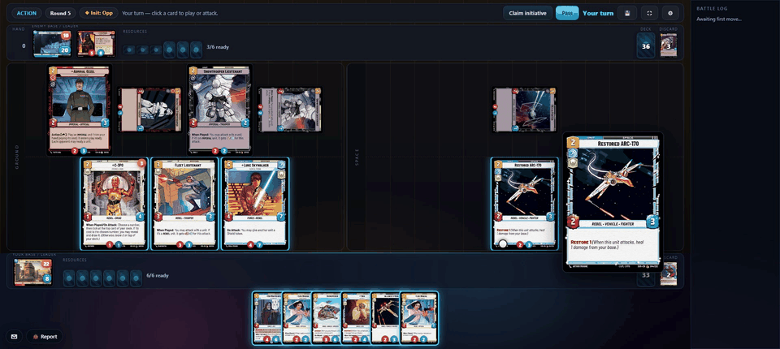
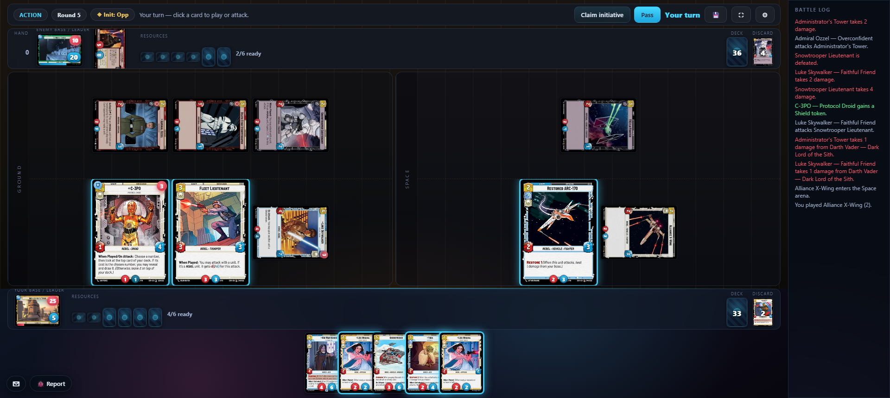

# SWU — a Star Wars: Unlimited rules engine

[](https://github.com/jrwillcox/swu-engine/actions/workflows/ci.yml)
[](pyproject.toml)
[](LICENSE)

A complete rules engine for the *Star Wars: Unlimited* card game, with all 2,636
cards playable. Play it in your browser against a heuristic or Claude-backed opponent.



> **Unofficial fan project.** Not affiliated with, endorsed by, or sponsored by
> Lucasfilm, Disney, Fantasy Flight Games or Asmodee. All card text, artwork,
> rules and trademarks belong to their respective owners. **The repository ships
> no card art and no card database**, with two exceptions: a small text-only test
> fixture, and the card images visible in this README's screenshots, which show
> the app running on a locally built database. The pipeline in `scripts/` builds
> the database and art locally from the publisher's public API. The code is MIT
> licensed; see [LICENSE](LICENSE) and [NOTICE.md](NOTICE.md).

## What's here

| | |
|---|---|
| **Card coverage** | **2,636 / 2,636 playable (100%)** — 2,176 registered in the ability framework, the rest fully handled by the keyword and vanilla layers. **0 escape hatches**, 0 keyword-deferred. Measured by `scripts/audit_coverage.py`, written to [`docs/coverage_report.md`](docs/coverage_report.md). |
| **Tests** | **Over 5,600 Python tests** (counting parametrisation), plus about 140 front-end tests and 2 Playwright e2e specs. |
| **Engine** | ~101k lines of Python across `src/swu/`, with a FastAPI backend; ~8k lines of React and TypeScript in `web/src/`. |
| **Opponents** | A transparent weighted-heuristic bot, an LLM-backed bot (Claude) that degrades visibly to the heuristic, and random/aggro/chaos bots for soak testing. |

## Quick start

Requires **Python ≥ 3.11** and **Node ≥ 20.19** (Vite 7). Windows PowerShell and
POSIX commands are both given; from a fresh clone:

```bash
python -m venv .venv
source .venv/bin/activate          # Windows: .\.venv\Scripts\Activate.ps1
pip install -e ".[dev,web]"
```

### 1. Build the card database (~1.5 hours, once)

The repository ships no card database, only a small test fixture. Build the
database from the official API — the steps
are resumable, so an interrupted run picks up where it left off:

```bash
python scripts/discover.py        # sample the API schema and sanity-check it
python scripts/fetch_metadata.py  # ~60-90 min, resumable, writes data/raw/pages/
python scripts/build_db.py        # parse pages -> data/swu.db (idempotent)
python scripts/validate.py        # summary table; non-zero exit on a critical fail
```

That is everything the engine, the bots and the test suite need.

**Card art is optional.** It only affects how the web UI looks — the app serves a
text fallback when an image is missing.

```bash
python scripts/fetch_images.py    # ~3 hours, ~700 MB; then fix_image_collisions.py
```

> **Please keep the harvester polite.** It sets a descriptive `User-Agent`, waits
> 1.5 s between requests and backs off on HTTP 429. A public repo multiplies
> whatever these scripts do by everyone who runs them, so treat those defaults as
> an obligation rather than a preference, and check the site's terms before
> running a full harvest.

### 2. Play

```bash
python -m swu.web                 # backend on 127.0.0.1:8000
cd web && npm install && npm run dev   # front end on :5173, proxies /api
```

Open <http://localhost:5173>, register an account and pick a deck. By default the
only username permitted to register is `player`; set `SWU_ALLOWED_USERS` to change
that (see [`.env.example`](.env.example)).



**No Anthropic API key is required.** *Easy* is a pure heuristic and never calls
an API. *Normal* and *Hard* use a small Claude model but fall back to the
heuristic — visibly, in the in-game log — on a missing key, a network hiccup or a
bad response. Set `ANTHROPIC_API_KEY` in the environment to enable them.

There is also a terminal driver:

```bash
python -m swu.cli --p0 random --p1 random --seed 7
```

## Architecture

```
        legal_actions(state) ──► every legal move, fully enumerated
                │
  Action ──► apply(state, action) ──► (new state, events[])
                │                              │
                │                              └─► the event log doubles
                │                                  as the UI's animation script
                ▼
      invariants.check(state)   ◄── 17 invariants, run after every move in soak
```

The engine is a pure `GameState → GameState` function: deep-copy then mutate,
seeded and deterministic, JSON round-trippable. Everything else is built on that
one contract.

- **`src/swu/engine/`** — state, actions, combat, keywords, the decision stack,
  the invariant oracle, and `views.py`, which redacts a state down to what one
  player may see.
- **`src/swu/abilities/`** — the card DSL. `registry.py` defines ability specs
  (triggers, effects, targets, conditions, durations); `resolver.py` interprets
  them against a state.
- **`src/swu/cards/<set>/abilities.py`** — the encodings themselves. **These are
  data, not logic** — large, flat files of declarations, which is why they are big.
- **`src/swu/players/`** — the `Player` protocol and every bot.
- **`src/swu/web/`** — FastAPI. `session.py` hands the client opaque action ids, so
  the front end cannot forge an illegal move.
- **`web/src/`** — React. **The front end knows no game rules**: it renders the
  redacted view, shows the legal actions the backend assigned, and animates the
  event stream.

One file looks alarming and is deliberate: `benchmarks/heuristic_baseline.py` is
a frozen copy of the heuristic bot, kept so `scripts/bot_arena.py` can A/B
against a fixed reference.

### `engine/actions/` — layered, not one file

For most of this project's life `engine/actions.py` was a single 24,788-line
module in 96 labelled sections. It is now a 24-module package. The split was done
as **pure text motion and proved as such**: all 1,098 definitions were checked
AST-identical to the pre-split file by `scripts/refactor_parity.py`, which
compares `{qualname: ast.dump(node)}` either side of the move, so the diff needed
no behavioural review. `swu.engine.actions` stays importable and still exposes
all **638** names, so none of the ~3,500 call sites changed.

A module may import only from modules **above** it in this table. That is
enforced rather than documented — `tests/test_actions_layering.py` parses the
package with `ast` and asserts on the edge set, because a layering with no test
decays back into a cycle one convenient import at a time.

| Layer | Modules | Lines |
|---|---|---|
| **Floor** — imports nothing in the package | `base` (the `Action` ABC) · `dispatch` (the decision-kind table) | 45 · 94 |
| **Kernel** — the cross-cutting primitives | `stats` · `costs` · `damage` · `zones` · `flow` · `shared` | 750 · 1,167 · 606 · 1,317 · 56 · 687 |
| **Pipelines** | `combat` · `observers` · `turn` | 3,288 · 660 · 532 |
| **Decision families** — one per mechanic, each claiming its own decision kinds from `dispatch` | `targeting` `upgrades` `modal` `distribute` `scheduling` `hand` `capture` `deck` `tokens` `sacrifice` `discard` `reveal` | 607–1,815 |
| **Top** | `api` (`legal_actions` / `apply`) · `__init__` (the facade, with an explicit `__all__`) | 1,933 · 1,357 |

Three details are worth knowing before reading it. `damage` sits *below* `zones`,
because putting a unit into play and drawing cards can both deal damage — the
placements came from the measured dependency graph, not from the names. `combat`
at 3,288 lines is the one module still over the 2,700-line target that the split
aimed at. And the assignment rule throughout was **dependency closure, not
section banner**: the old banners named the card that motivated the code rather
than what the code does, so following them would have scattered the kernel.

The package no longer imports the ability layer at module scope, which is what
the old file's ~319 function-local imports existed to avoid. The remaining lazy
imports are the genuinely cyclic ones and are pinned as such by the same test:
`swu/cards/__init__.py` registers every set's abilities on import, and
`engine/state.py` needs `cards.models` at runtime, so the card modules and
`abilities.resolver` must keep reaching into `actions` from inside their
functions.

Deeper notes: [`docs/ARCHITECTURE.md`](docs/ARCHITECTURE.md) ·
[`docs/ability_framework.md`](docs/ability_framework.md) ·
[`docs/README.md`](docs/README.md) (index).

## What's interesting here

- **Cards as data.** 2,176 cards are declarations composed from a fixed
  vocabulary of effect primitives, with **zero** escape hatches — no card falls
  back to bespoke imperative code.
- **An invariant oracle** (`src/swu/engine/invariants.py`): card conservation by
  instance identity, zone/tag consistency, decision-stack wellformedness,
  semantic modifier expiry, and **hidden-information leak detection** — it
  serialises `view_for(player)` and string-scans it to prove the opponent's hand
  never leaks. Run after every action in soak mode.
- **Property-based testing that shrinks.** `tests/test_hypothesis_engine.py`
  drives whole games one legal action at a time and runs that same oracle after
  every move, shrinking any failure to a minimal reproducer. Where the campaign
  runner waits for a bad state, this searches for one.
- **Variance-reduced bot benchmarking.** `scripts/bot_arena.py` plays every
  (deck-pair, seed) twice with the bots swapped, so seat and deck advantage
  cancel exactly and a 2–3 point win-rate change is signal rather than noise.
- **A resumable data pipeline** that samples the API schema before committing to
  a 90-minute harvest, and gates the database build on a manifest proving the
  harvest completed.
- **A refactor gate that proves rather than samples.** Decomposing the 24,788-line
  `actions.py` was verified by `scripts/refactor_parity.py`, which compares
  `{qualname: ast.dump(node)}` between the pre-split file read out of git and the
  new package: a pure move gives exact equality, while any edit to a body shows up
  as a mismatch. It carries a `--self-test` and a short waiver list, and a second
  mode (`--decision-arms`) proves 74 of the 75 decision kinds still route to code
  identical to the 601-line `if/elif` chain the dispatch table replaced — the one
  waiver is a dead store the split exposed, recorded with its reason rather than
  silenced. The seeded
  trace oracle alongside it (`scripts/trace_oracle.py`) is deliberately documented
  as **sampling** — it missed a `max(0,` → `max(1,` perturbation that AST parity
  pinpointed, which is the argument for having both.

## Tests

```bash
pytest                       # fast tier (~8 min with the full card database)
pytest -m slow               # soak + Hypothesis stateful machine (~6 min)
ruff check . && mypy         # lint, then typecheck the typed core
cd web && npm run lint && npm run typecheck && npm test     # front end
cd web && npx playwright test               # e2e (starts its own servers)
```

**A fresh clone runs the tests for real, without building the card database.**
`tests/fixtures/swu_fixture.db` is committed — a few hundred card definitions
(text and stats only, no artwork), built by
[`scripts/make_fixture_db.py`](scripts/make_fixture_db.py) from exactly the cards
the engine, keyword, web and regression suites load. How much runs depends on
which database the tests find:

| | tests run | wall clock |
|---|---|---|
| Committed fixture (a fresh clone, and CI) | **about 1,600** | ~1.5 min |
| Full corpus, after the pipeline | **over 5,600** | ~8 min |

What the fixture can't cover skips with a reason rather than failing: the per-set
card suites (one test per printed card across 24 sets), the coverage audit, the
reprint sweep and the per-deck gates all need the real corpus.
[`tests/fixture_scope.py`](tests/fixture_scope.py) draws that line in one place,
and `scripts/make_fixture_db.py --record` re-derives the fixture's contents by
instrumenting the suite rather than trusting a hand-maintained list.

```bash
python scripts/soak.py --games 10000 --jobs 8   # overnight campaign
python scripts/replay.py failures/<bundle>.json # reproduce a failure
python scripts/shrink.py failures/<bundle>.json # minimise it
```

## How this was built

This project was built with heavy use of Claude Code, and the machinery for doing
that safely is part of the repository rather than hidden: a deterministic offline
planner that clusters unimplemented cards into dependency-ordered work groups
(`scripts/plan_encoding.py`), per-card acceptance criteria for each group
(`encoding/*/MANIFEST.md`), and an automated release gate
(`scripts/verify_encoding.py --graduate`) that refuses to ship a deck below 100%
coverage with green suites. See [`docs/methodology.md`](docs/methodology.md).

## Licence

Code: MIT ([LICENSE](LICENSE)). Card text, artwork and trademarks are not covered
by that licence; see [NOTICE.md](NOTICE.md).
